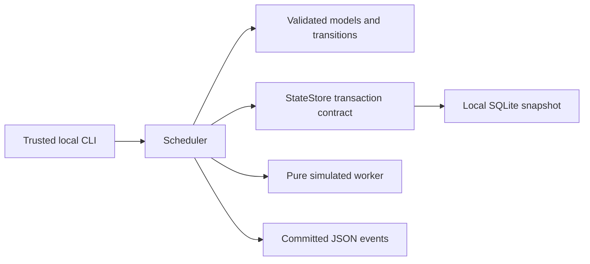

# Architecture and decisions

## Scope and boundaries

The system separates deterministic orchestration from execution. Phase 1 proves
policy with a simulated worker; the same scheduler accepts a transactional
`StateStore` contract without depending on SQLite queries. It does not pretend
that a local database survives ephemeral GitHub-hosted runners.

1. The CLI validates configuration and submits explicit user decisions.
2. The scheduler atomically claims a task and returns a detached task copy.
3. Execution occurs outside the storage transaction.
4. The scheduler checks ownership and atomically commits output, checkpoint,
   transition, and audit. It releases the claim after every stage.
5. The run loop immediately checks for another eligible task. Approval never
   holds the worker; a later approval only marks the task ready.

## Decisions and tradeoffs

- **Python 3.11+, Pydantic 2, JSON:** small dependency surface, typed schemas,
  rejection of unknown fields. JSON avoids YAML parser ambiguity. No framework
  or orchestration service is needed for the prototype.
- **SQLite snapshot:** a single versioned JSON document keeps the persistence
  adapter understandable. `BEGIN IMMEDIATE` serializes read/modify/write across
  processes on one machine. Task data and audit commit together; failed
  transactions roll back. The whole snapshot is rewritten per transaction, so
  this is intentionally unsuitable for large histories or distributed workers.
- **Single logical claim:** at most one RUNNING task in the database. Unique
  ownership tokens fence stale results; leases allow restart recovery. Tokens
  protect commits, not arbitrary external side effects. Exactly-once external
  execution is not claimed.
- **Stage checkpoints:** the checkpoint is the next stage index; simulated output
  is keyed by stage index and name. Approval stages advance the index when the
  request is checkpointed, then block until an explicit decision. No generated
  output or approved asset exists yet.
- **Deterministic ordering:** highest integer priority first, original enqueue
  sequence breaks ties. This favors finishing older tasks; sustained high
  priority work may starve lower priorities. Aging/fairness is a Phase 4 decision.
- **Bounded retry:** exponential backoff, configured cap, no jitter for repeatable
  simulation. The retry allowance is per task across stages and recoveries.
  Exhausted tasks terminate FAILED. Manual `/portfolio retry` is planned, not
  implemented; a new explicit idempotency key can start a separate local task.
- **Audit before telemetry:** database events commit atomically with state.
  stderr events emit after commit and may be missing if the process crashes in
  that gap; the audit remains the source of truth.

## Persistence evolution

`StateStore.transaction()` must provide isolation, atomic commit, rollback, and
schema validation. Backends must reject unsupported versions rather than reset
state. Phase 1 has no migrations; back up the database before future schema changes.
The adapter is synchronous, with a bounded 30-second SQLite lock timeout. Disk
failure or corruption fails closed and requires operator investigation.

Phase 4 must choose genuinely shared persistence accessible from separate runners,
with conditional writes, ownership fencing, artifact storage, and an atomic outbox
or equivalent wakeup mechanism. Actions concurrency alone is not a queue. Runner
artifacts and caches alone are not an authoritative task database. The local
snapshot protocol may need refinement to express remote compare-and-swap safely.

Future generation stages should write immutable, task-specific artifacts and
commit references after validation. A bounded worker needs stage deadlines,
heartbeat/lease renewal, checkpoint compatibility checks, and continuation dispatch.
The current budget only checks between instantaneous simulated stages; it cannot
interrupt or safely bound real LLM execution.

## Future boundaries

Discovery and Issue adapters will call the application layer after authentication
and authorization. Repository analysis will read bounded data without executing
source. LLM providers (Ollama, llama.cpp, mock) will return schema-validated,
untrusted data through a separate execution interface. Publishing will consume
approved artifacts and create reviewable PRs under an explicit output contract.
Case study and gallery card tasks will be independent. No website code is generated.

## Phase 2 discovery boundary

The CLI now exposes a separate discovery application service and a bounded GitHub
REST adapter. `discover` records public repository metadata; `notify` previews
Issue requests; `notify --apply` delivers them. Registry, notification, and discovery
audit tables share the local SQLite file but do not alter the Phase 1 task snapshot
or authorize any scheduler task. Stable GitHub repository IDs survive renames.

Issue creation uses a committed local reservation and remote marker reconciliation.
Ambiguous requests remain blocked from automatic re-creation. This is a conservative
single-machine delivery protocol, not a distributed queue or exactly-once remote
transaction. Read [discovery](discovery.md) for operational limits and recovery.
